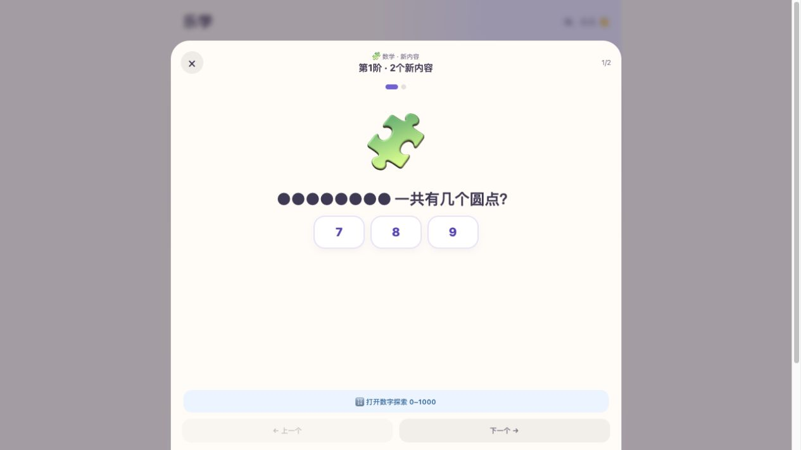
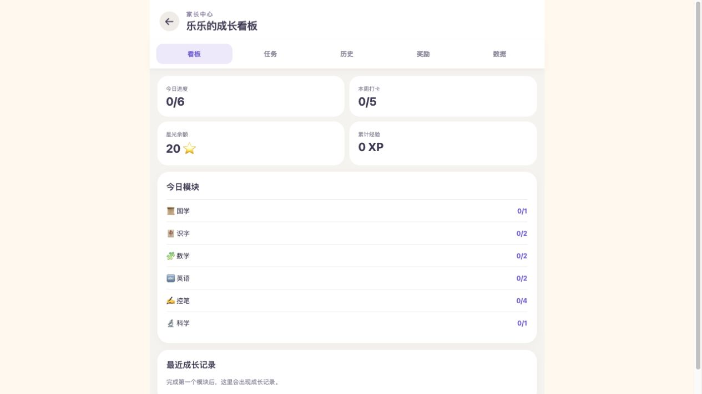

# 乐学项目评估与优化建议

评估日期：2026-09-15；当前版本：0.4.0。

## 1. 总体判断

现有项目已经形成「每日计划 → 学习 → 奖励 → 宠物成长 → 家长管理」的完整框架。下一阶段最有价值的方向是提高选课的适配程度、学习记录的可信度，以及异常情况下的数据可靠性。

目前适合定位为家长陪伴下的幼儿启蒙工作台。若希望孩子独立使用，需要进一步补齐题目朗读、操作引导和学习反馈。

## 2. 现有功能

| 领域 | 已有能力 |
| --- | --- |
| 学习内容 | 国学、识字、数学、英语、控笔、科学；README 标注内置 1834 项课程 |
| 学习计划 | 学习日设置、模块开关、每日新内容量、固定间隔复习、当天内容调整 |
| 学习交互 | 内容朗读、选择题、描红、数字探索 |
| 激励 | 星光、粮食、经验、宝石、勋章、宠物养成、兑换审批 |
| 家长管理 | 看板、学习历史、资料库编辑、年龄筛选、AI 新增资料草稿 |
| 数据与交付 | IndexedDB 本地存储、JSON 备份恢复、内容包导入、PWA、Docker 与版本发布流程 |

已有值得保留的设计：完成奖励使用固定键；完成事件与对应奖励使用事务写入；AI 内容先由家长检查再保存；语音与 AI 密钥保留在服务端。

## 3. 按优先级推进

### 3.1 优先修复功能与数据问题

1. **清空数据后，当天计划缺失。** `App.tsx:335` 清空后只调用 `refresh()`；`refresh()` 只加载数据，而生成计划的 effect 依赖日期。日期未变时不会重新生成，`App.tsx:328` 会进入持续加载状态。恢复一个没有当天计划的旧备份也存在同类问题。建议将「加载并确保当天计划存在」收敛成统一入口。此结论来自代码路径，未实际清空现有浏览器数据。
2. **部分学习记录没有参与后续选课。** 历史页通过 `doneItemIds` 标记单条内容已学，但排课只读取整个模块完成后才产生的 `CompletionEvent`。例如学完 2 个汉字中的 1 个后退出，这个字在历史页是已学，次日排课仍可能将它当新内容，也不会据此安排到期复习。建议统一使用逐条学习事件，模块完成只负责模块奖励。
3. **进度、奖励、报告不是一次完整提交。** `markItem()` 分别保存完成事件、计划和报告；兑换也分开保存扣款与审批状态。中途失败可能造成状态不一致。建议在一个数据库事务内提交关联记录，并处理连点、多标签页旧状态和失败重试。固定完成键能防部分重复发奖，但不能覆盖全部一致性问题。
4. **数据导入校验不完整。** `validateContentPack()` 未校验模块与类型组合、答案是否属于选项；`items` 不是数组时仍可能执行 `forEach`。`validateBackup()` 只检查少数顶层字段。建议统一手工新增、AI 新增、内容包与备份的字段规则，并在覆盖前显示摘要、生成恢复前备份。
5. **内置课程升级会覆盖同 ID 的家长编辑。** `db.ts` 在内置内容版本变化时直接 `put` 内置条目。建议区分内置原件与家长修改版本，升级时保留修改，提供差异查看。

验收重点：清空与旧备份恢复后直接进入可用首页；部分完成的内容在历史和排课中口径一致；写入失败不出现只扣款或只发奖；无效内容导入前被明确拒绝。

### 3.2 优先优化学习体验

| 优先级 | 优化方向 | 当前依据 | 建议 |
| --- | --- | --- | --- |
| 高 | 学习效果记录 | 多数内容点击「我学会啦」即可完成；描红只判断是否产生笔迹；选择题错误次数不保存 | 先增加「独立完成／需要提示／还需练习」，保留首次作答和错误次数。描红先补笔画示范与重练，避免把简单覆盖率当作准确书写评分 |
| 高 | 自动选课适配 | 内容已有年龄字段，但设置没有孩子年龄，选课也未使用年龄；数学按完成模块次数每 10 次升阶 | 增加年龄与起点设置；按难度、前置知识、实际表现选课；允许家长调整起点 |
| 高 | 数学语音 | 实际题目页没有朗读按钮，`TaskModal.tsx:28` 显式排除了数学 | 提供题目朗读与可重复提示；点数题可逐个高亮圆点，帮助理解题意 |
| 中 | 首页开始学习 | 宠物、余额和安装提示排在任务之前；六个模块并列 | 增加显著的「开始／继续学习」，默认定位未完成内容；学习清单保持可选 |
| 中 | 每日学习量 | 默认六模块共 12 个新内容，到期复习可额外补入；没有总时长目标 | 设置短时学习目标和休息提示，显示新学与复习总量；支持今天少学一点 |
| 中 | 家长看板 | 展示进度、打卡、积分、经验，缺少困难项与建议 | 展示本周新学、待巩固、常见困难，以及下一次建议；依赖逐条学习事件建设 |
| 中 | 学习周目标 | 学习日可自定义，但周奖励与看板固定为 5 天 | 将目标设为可配置或与计划学习日联动，避免设为每周 3 天却无法正常达成周目标 |

### 3.3 服务与维护优化

- **公开使用前补服务端访问控制与成本边界。** 两个付费接口已有全局并发与频率限制，也检查跨站请求头；但没有用户或设备身份校验，外部客户端可不发送该头。建议补设备授权或会话、按设备限流、日额度与告警。是否已有生产网关保护，本次未核验。
- **补启动失败和保存失败页面。** 初始化的异步任务缺少统一错误展示，部分写入失败也未向用户反馈；应允许重试和导出可恢复数据。
- **明确更新时机。** PWA 配置自动更新，且控制器变化时直接刷新。建议在学习完成或空闲时应用更新，避免打断当前描红和作答。生产升级行为待单独验证。
- **降低全量加载成本。** 当前加载所有历史、流水和报告，后续可按日期分页查询；先用半年或一年样例数据测量，再决定是否拆包和优化渲染。当前构建主 JS 313.90 kB，gzip 106.84 kB，尚无证据说明必须优先重构前端框架。
- **补关键流程测试。** 现有 49 项测试通过，但主要覆盖纯逻辑与模拟服务。优先补浏览器数据库集成、部分学习、备份恢复、事务失败、兑换连点和版本更新测试。
- **语音可靠性。** 当前在线语音有超时和部分下载重试。可先增加服务健康状态、失败原因分类与重复请求合并；本次未调用真实付费接口，也不对真实延迟作结论。

## 4. 本次页面走查

截图均为本次本机桌面浏览器视口的真实页面，已保存并重新打开检查。没有在现有记录上执行答题完成、兑换、清空或恢复操作。

### 步骤 1：首页选择学习 — 可用，开始学习的主入口可以更突出

优点：模块进度、奖励余额清楚，整体颜色和卡片风格一致。问题：宠物和安装提示占据较多首屏空间，学习操作位于下方。辅助文字偏小、颜色较浅，需进一步测量对比度。

### 步骤 2：打开数学题 — 可用，缺少读题与具体提示

优点：选择项集中、上下一题明确。问题：需要自行理解中文题意；数字探索入口与当前任务并列，容易让学习流程分叉。打开弹窗后焦点仍在背景模块按钮，建议补弹窗焦点转移、约束与关闭后恢复；本次未做完整键盘或读屏测试。

### 步骤 3：兑换与家长入口 — 可用，兑换条件可以提前表达

余额不足的奖励仍展示同样的「想要」按钮，需点击才提示差额。建议直接标注「还差 10 星光」或可兑换状态。家长入口位于此页，初次使用可增加入口引导，后续仍可保留现有位置。

### 步骤 4：家长看板 — 可用，学习效果信息不足

使用本机既有默认口令进入成功。看板结构清楚，但当前主要回答「做了多少」，缺少「哪里不会、接下来练什么」。应先补记录，再生成建议，避免用完成数量推断能力。

## 5. 建议实施顺序

1. 修复计划恢复、统一逐条学习记录、完善事务与导入校验。
2. 增加数学读题、首页继续学习，以及年龄和学习起点。
3. 用真实学习表现驱动复习计划和家长周报。
4. 根据是否开放给更多家庭，再推进账号、多设备同步和服务额度管理。

## 6. 验证范围

- `CI=true pnpm test`：9 个测试文件，49 项测试通过。
- `CI=true pnpm build`：TypeScript 检查、前端构建和 PWA 生成通过。
- 核查了主要业务逻辑、数据存储、课程交互、家长管理、语音与内容生成服务代码。
- 页面检查覆盖上述四个步骤；未进行真实手机、iOS 安装、离线切换、线上部署、真实语音或 AI 生成验证。
- 本次只新增评估文档与截图，未修改产品代码。
